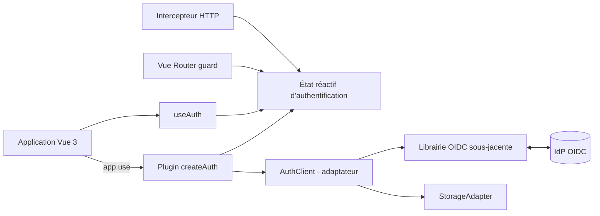
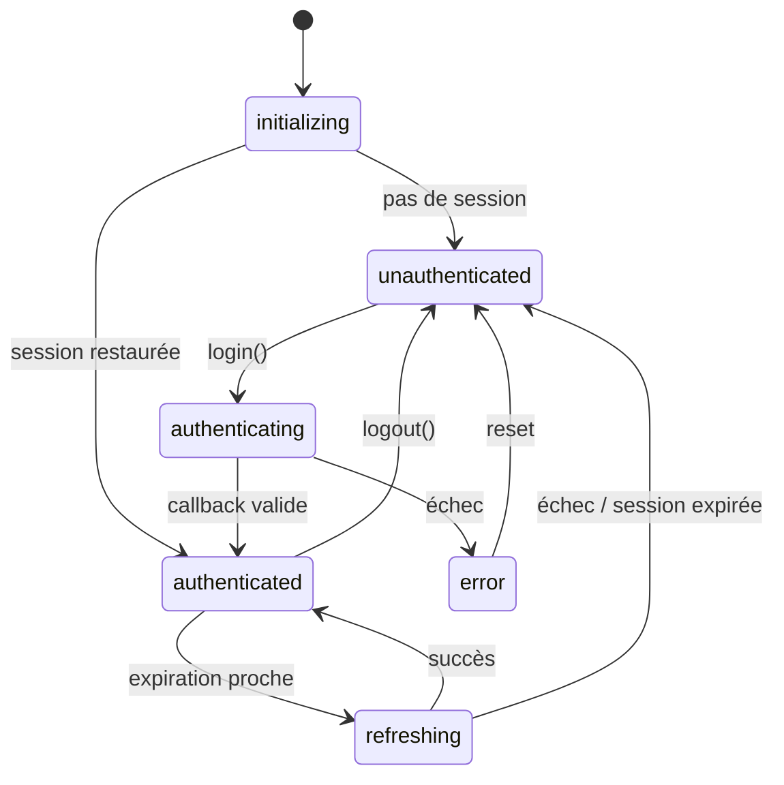

# Spécification — Librairie d'authentification Vue 3 (OAuth 2.0 / OIDC)

## Historique des modifications

| Version | Date | Auteur | Description |
|---|---|---|---|
| 0.1.0 | 2026-10-13 | À compléter | Création du document |
| 0.2.0 | 2026-10-13 | À compléter | Ajout des exemples d'usage ; `useAuth()` imposé comme point d'accès unique |
| 0.3.0 | 2026-10-13 | À compléter | Variables d'environnement `IAM_*` ; conservation de la session au rechargement ; décisions : SPA sans backend, restauration par renouvellement silencieux |
| 0.4.0 | 2026-10-13 | À compléter | Annexe D : exemple d'`AuthClient` avec `oidc-client-ts` et `keycloak-js` |
| 0.5.0 | 2026-10-14 | À compléter | Prise en compte de la relecture : périmètre v1 (OIDC générique, un seul adaptateur `oidc-client-ts`), `on()` et événements, `silentRestore`, configuration build-time/runtime, répartition des responsabilités de sécurité (§6.4), comportement en cas d'échec de restauration, restriction d'envoi du token (`apiBaseUrls`) |
| 0.5.1 | 2026-10-14 | Jean-Philippe Bazonnais | Auteurs et relecteurs renseignés ; NO7 clarifié ; ligne « Démos » alignée sur ADR-001 ; navigateurs cibles consignés ; annexe E (claims et rôles) et entrées de glossaire associées |
| 0.6.0 | 2026-10-15 | Jean-Philippe Bazonnais | FR-008 supprimé (identifiant non réutilisé) ; ADR-002 décidé (mémoire) ; décisions sur les questions ouvertes (conformité, options du guard, `resetAuth()`) ; FR-028 et FR-029 ; exemple d'implémentation de `apiBaseUrls` (annexe B.2) |
| 0.6.1 | 2026-10-15 | Jean-Philippe Bazonnais | Options `autoRefresh` et `refreshSkewSeconds` et variable `IAM_REFRESH_SKEW_SECONDS` retirées ; calendrier du renouvellement délégué à la librairie sous-jacente |
| 0.6.2 | 2026-10-15 | Jean-Philippe Bazonnais | Ajout de NFR-009 et NFR-010 (concision et maintenabilité du code) ; seuils `X` et `N` laissés à définir |
| 0.6.3 | 2026-10-15 | Jean-Philippe Bazonnais | Seuils NFR-002, NFR-009 et NFR-010 définis et vérifiés en CI ; couverture reportée hors gate bloquant |
| 0.6.4 | 2026-10-15 | Jean-Philippe Bazonnais | Contrat du logger précisé : messages debug, contexte allowlisté et aucun secret ; tests SEC-005/NFR-007 |
| 0.6.5 | 2026-10-15 | Jean-Philippe Bazonnais | Ajout de `vue-logger-plugin` comme dépendance runtime et encapsulation dans la classe `Logger` |
| 0.6.6 | 2026-10-15 | Jean-Philippe Bazonnais | `vue-logger-plugin` activé au niveau debug par défaut ; callback logger optionnel et exceptions isolées |

## Conventions

Les mots-clés **DOIT**, **NE DOIT PAS**, **DEVRAIT**, **NE DEVRAIT PAS** et **PEUT** sont à interpréter comme décrit dans la [RFC 2119](https://www.rfc-editor.org/rfc/rfc2119).

Chaque exigence porte un identifiant unique et une priorité MoSCoW :

- `FR-xxx` : exigence fonctionnelle
- `NFR-xxx` : exigence non fonctionnelle
- `SEC-xxx` : exigence de sécurité
- Priorité : **M** (Must), **S** (Should), **C** (Could), **W** (Won't, hors périmètre de cette version)

## Glossaire

| Terme | Définition |
|---|---|
| IdP | Fournisseur d'identité (Identity Provider), par ex. Keycloak |
| OIDC | OpenID Connect, couche d'identité au-dessus d'OAuth 2.0 |
| Access token | Jeton permettant d'appeler une API protégée |
| Refresh token | Jeton permettant d'obtenir un nouvel access token |
| ID token | Jeton OIDC décrivant l'identité de l'utilisateur authentifié |
| PKCE | Proof Key for Code Exchange (RFC 7636) |
| SPA | Single Page Application |
| Composable | Fonction Vue 3 encapsulant une logique réactive (`useXxx`) |
| Librairie sous-jacente | Librairie OAuth/OIDC tierce encapsulée (voir §2.3) |
| Intégrateur | Développeur qui utilise la librairie dans son application |
| Claim | Information sur l'utilisateur ou sur le token, contenue dans un JWT (paire nom / valeur), par ex. `sub`, `email`, `exp` (voir annexe E) |
| Rôle | Claim particulier : étiquette de permission attribuée à l'utilisateur, par ex. `admin` (voir annexe E) |

---

## 1. Introduction

### 1.1 Contexte et problème

<!-- À compléter : pourquoi cette librairie ? Quels projets l'utiliseront ? -->
Les applications web Vue 3 doivent s'authentifier auprès d'un IdP OIDC. L'intégration directe d'une librairie OAuth/OIDC dans chaque application conduit à du code dupliqué (initialisation, gestion du cycle de vie des tokens, guards de routes, intercepteurs HTTP) et à des divergences de sécurité.

La présente librairie fournit une couche d'intégration Vue 3 **au-dessus d'une librairie OIDC existante**, sans réimplémenter le protocole.

### 1.2 Objectifs

- O1. Offrir une intégration Vue 3 idiomatique (plugin + composables) de l'authentification OIDC.
- O2. Masquer la complexité de la librairie sous-jacente derrière une API stable et typée.
- O3. Imposer des défauts sûrs (Authorization Code + PKCE, validation `state`/`nonce`).
- O4. Faciliter la protection des routes et l'appel d'API protégées.

### 1.3 Non-objectifs

- NO1. Réimplémenter le protocole OAuth 2.0 / OIDC.
- NO2. Fournir un serveur d'autorisation ou une gestion des utilisateurs côté serveur.
- NO3. Supporter Vue 2 (Options API legacy incluse).
- NO4. Supporter les flux dépréciés (Implicit, Resource Owner Password Credentials).
- NO5. Exposer une API globale (`$auth`, `globalProperties`), un mixin ou des méthodes sur l'instance du plugin : le composable `useAuth()` est le seul point d'accès (FR-002, FR-017, ADR-004).
- NO6. Supporter une architecture avec backend / BFF : l'application est 100 % front (SPA).
- NO7. Supporter plusieurs IdP ou plusieurs clients dans une même application, y compris l'un après l'autre (modèle singleton, FR-018).
- NO8. Livrer plusieurs adaptateurs OIDC en v1 : seul `oidc-client-ts` est supporté (ADR-001).
- NO9. <!-- À compléter -->

### 1.4 Public cible

Développeurs d'applications front Vue 3 (TypeScript ou JavaScript) consommant un IdP OIDC.

### 1.5 Références

- RFC 6749 — OAuth 2.0 Authorization Framework
- RFC 7636 — PKCE
- RFC 8252 / OAuth 2.0 Security Best Current Practice (draft-ietf-oauth-security-topics)
- OAuth 2.0 for Browser-Based Applications (draft-ietf-oauth-browser-based-apps)
- OpenID Connect Core 1.0
- Documentation Vue 3, Vue Router 4
- Documentation de la librairie sous-jacente retenue (§2.3)

---

## 2. Périmètre et hypothèses

### 2.1 Types d'applications supportées

| Type | Support | Remarque |
|---|---|---|
| SPA Vue 3 sans backend (client public) | Oui (cible principale) | Pas de client secret |
| SPA avec backend (BFF) | Non | Application 100 % front, aucun backend |
| SSR / Nuxt | Non (v1) | Hors périmètre |

### 2.2 Protocoles et flux

- Authorization Code Flow **avec PKCE (S256)** : obligatoire.
- OIDC : découverte (`.well-known/openid-configuration`), ID token, endpoint `userinfo`.
- Déconnexion : RP-Initiated Logout.
- Cible de la v1 : **OIDC générique**. Keycloak est l'IdP de référence pour les tests, sans dépendance au produit dans l'API publique (ADR-005).

### 2.3 Librairie OIDC sous-jacente

> **Décision v1 (ADR-001)** : `oidc-client-ts` est la seule librairie officiellement supportée. `keycloak-js` n'est pas livré en v1 ; l'interface `AuthClient` permet de l'ajouter ensuite sans breaking change.

| Critère | `oidc-client-ts` | `keycloak-js` | Autre |
|---|---|---|---|
| Agnostique de l'IdP | Oui | Non (Keycloak) | |
| Maintenance / communauté | À vérifier | À vérifier | |
| Taille du bundle | À mesurer | À mesurer | |
| Silent renew (iframe / refresh token) | Oui | Oui | |
| Typage TypeScript | Oui | Oui | |

La librairie sous-jacente **DOIT** être encapsulée derrière une interface interne (`AuthClient`) afin de pouvoir la remplacer sans breaking change pour l'intégrateur. L'annexe D donne l'adaptateur `oidc-client-ts` (v1) et, à titre d'illustration, un adaptateur `keycloak-js`.

### 2.4 Contraintes techniques

| Contrainte | Valeur |
|---|---|
| Vue | ≥ 3.4 <!-- à ajuster --> |
| Vue Router | ≥ 4.x (optionnel, peer dependency) |
| Langage | JavaScript (types fournis) |
| Navigateurs cibles | Dernières versions des navigateurs evergreen |
| Format de distribution | ESM |
| Poids maximal (min+gzip) | À définir |

### 2.5 Hypothèses

- H1. L'IdP expose un endpoint de découverte OIDC conforme.
- H2. Le client est enregistré comme **client public** avec `redirect_uri` et `post_logout_redirect_uri` exacts.
- H3. L'application et l'IdP sont servis en HTTPS.
- H4. L'application est 100 % front (SPA), sans backend ni BFF.
- H5. Par défaut (`silentRestore` activé), la restauration de la session au rechargement repose sur le renouvellement silencieux (stockage en mémoire par défaut). Désactivée, un rechargement de page déconnecte l'utilisateur.

---

## 3. Architecture

### 3.1 Composants



| Composant | Responsabilité |
|---|---|
| Plugin `createAuth` | Initialisation et configuration uniquement (n'expose aucune API d'authentification) |
| État réactif | `user`, `isAuthenticated`, `status`, `error` |
| `AuthClient` | Adaptateur vers la librairie sous-jacente |
| `StorageAdapter` | Persistance (mémoire, `sessionStorage`, personnalisé) |
| Composable `useAuth` | Point d'accès unique à l'API publique (dans et hors composants) |
| Guard de route | Protection des routes (`meta.requiresAuth`) |
| Intercepteur HTTP | Ajout du `Authorization: Bearer` |

### 3.2 Machine à états



### 3.3 Séquences principales

<!-- À compléter : diagrammes de séquence détaillés -->

1. **Login** : `login()` → redirection IdP → saisie des identifiants → retour sur `redirect_uri` avec `code` + `state` → échange du code (PKCE) → état `authenticated`.
2. **Callback** : validation de `state`, `nonce` et des claims de l'ID token par la librairie sous-jacente (voir §6.4).
3. **Renouvellement** : silent renew (refresh token ou iframe selon librairie/IdP).
4. **Logout** : révocation/suppression locale, redirection vers `end_session_endpoint`.

---

## 4. Exigences fonctionnelles

| ID | Exigence | Prio | Vérification |
|---|---|---|---|
| FR-001 | La librairie DOIT s'installer via `app.use(createAuth(options))`. `createAuth()` DOIT retourner un plugin Vue sans exposer de méthode ni d'état d'authentification. | M | Test unitaire |
| FR-002 | Le composable `useAuth()` DOIT être le seul point d'accès public à l'état et aux actions d'authentification. | M | Revue de l'API publique + test unitaire |
| FR-003 | `login()` DOIT rediriger vers l'IdP en Authorization Code + PKCE (S256). | M | Test d'intégration (IdP mocké) |
| FR-004 | `login()` DOIT permettre de fournir une URL de retour (`returnTo`) restaurée après le callback. | S | Test d'intégration |
| FR-005 | La librairie DOIT traiter le callback (`code`, `state`) et nettoyer l'URL après traitement. | M | Test d'intégration |
| FR-006 | `logout()` DOIT terminer la session locale et la session IdP (RP-Initiated Logout). Aucune option de déconnexion locale seule n'est proposée en v1. | M | Test d'intégration |
| FR-007 | La librairie DOIT, par défaut, restaurer une session existante au démarrage de l'application. Cette restauration est désactivable par l'option `silentRestore`. | M | Test d'intégration |
| FR-009 | En cas d'échec de renouvellement, l'état DOIT passer à `unauthenticated` et un événement `sessionExpired` DOIT être émis. | M | Test unitaire |
| FR-010 | La librairie DOIT fournir un guard Vue Router (`createAuthGuard`) protégeant les routes marquées `meta.requiresAuth`. | M | Test d'intégration |
| FR-011 | `getAccessToken()` DOIT retourner un token valide (en déclenchant un renouvellement si nécessaire) ou lever une erreur typée. | M | Test unitaire |
| FR-012 | La librairie DEVRAIT fournir un helper HTTP optionnel (par ex. `createAuthFetch`) qui ajoute le token et gère un 401 par un unique renouvellement suivi d'une seule nouvelle tentative. Il NE DOIT PAS ajouter de dépendance runtime (NFR-005) et NE DOIT ajouter l'en-tête `Authorization` que pour les URLs couvertes par `apiBaseUrls` (SEC-012). | S | Test unitaire |
| FR-013 | La librairie DEVRAIT synchroniser l'état d'authentification entre onglets (login/logout). | S | Test e2e multi-onglets |
| FR-014 | La librairie DEVRAIT permettre un contrôle d'accès basé sur les rôles (`hasRole`) ; les claims restent accessibles en lecture via `user.claims`. Ces contrôles relèvent de l'ergonomie : l'autorisation est vérifiée par l'API. | S | Test unitaire |
| FR-015 | La librairie PEUT exposer un composant `<AuthGuard>` / directive `v-auth`. | C | Test unitaire |
| FR-016 | Le support SSR / Nuxt n'est PAS requis en v1. | W | — |
| FR-017 | `useAuth()` DOIT être utilisable dans un composant (`setup`) **et** hors composant (guard de routeur, client HTTP, store, module utilitaire), une fois le plugin installé. | M | Test unitaire dans les deux contextes |
| FR-018 | Tous les appels à `useAuth()` d'une même application DOIVENT partager le même état réactif (singleton par application). | M | Test unitaire |
| FR-019 | Un appel à `useAuth()` avant l'installation du plugin DOIT lever l'erreur `NOT_INSTALLED` avec un message explicite. | M | Test unitaire |
| FR-020 | Lorsque `silentRestore` est activé (défaut), le rafraîchissement de la page (rechargement du navigateur) DOIT conserver le statut de connexion : si la session IdP est valide, `isAuthenticated` redevient `true` et `user` est restauré sans action de l'utilisateur ni écran intermédiaire. Si la session IdP a expiré, l'état DOIT passer à `unauthenticated` sans boucle de redirection. | M | Test e2e (rechargement sur une page protégée, session valide puis expirée) |
| FR-021 | Pendant la restauration (`status = 'initializing'`), l'application NE DOIT PAS présenter l'état « non connecté » et le guard de routes DOIT attendre la fin de l'initialisation avant de décider d'une redirection. | M | Test e2e + test d'intégration du guard |
| FR-022 | La librairie DOIT pouvoir être configurée par les variables `IAM_*` du §5.2.1, via un helper `authOptionsFromEnv(env)` qui accepte tout objet `Record<string, string \| undefined>` : `import.meta.env` (injection au build) ou une configuration chargée au runtime (`window.__ENV__`, `config.json` lu avant le montage de l'application). La librairie NE DOIT PAS lire elle-même `import.meta.env` ni `process.env`, ni charger de fichier de configuration. | M | Test unitaire avec un objet `env` simulé |
| FR-023 | Priorité de configuration : options passées à `createAuth()` > variables d'environnement > valeurs par défaut. | M | Test unitaire |
| FR-024 | Une variable obligatoire manquante ou invalide (URL non HTTPS hors `localhost`, valeur de `IAM_STORAGE` inconnue, durée non numérique) DOIT provoquer l'erreur `CONFIG_INVALID` nommant les variables en cause. | M | Test unitaire |
| FR-025 | `useAuth()` DOIT exposer `on(event, handler)` pour s'abonner aux événements du §5.5. `on()` DOIT retourner une fonction de désabonnement, appeler les handlers après la mise à jour de l'état et isoler les exceptions d'un handler (elles ne bloquent pas les autres). | M | Test unitaire |
| FR-026 | Si la restauration silencieuse échoue pour une raison liée au navigateur ou à l'IdP (cookies tiers bloqués, iframe bloquée, délai dépassé), l'état DOIT passer à `unauthenticated`, un événement `error` DOIT être émis et aucune redirection automatique NE DOIT être déclenchée au démarrage. L'absence de session IdP (`login_required`) n'est pas une erreur. Ce comportement est normal et acceptable : l'utilisateur se reconnecte par redirection (transparente si la session SSO est active). | M | Test d'intégration (iframe bloquée, délai dépassé) |
| FR-027 | Le guard NE DOIT PAS déclencher plus d'une redirection automatique vers l'IdP par navigation. Un retour de l'IdP sans session valide (erreur, `login_required`) DOIT aboutir à l'état `error` et à l'événement `error`, jamais à une nouvelle redirection. | M | Test d'intégration avec IdP mocké renvoyant une erreur |
| FR-028 | `createAuthGuard(options?)` DOIT accepter les options `forbiddenRoute` et `callbackRouteNames` (§5.4). Les routes de callback sont exclues du guard ; sans `forbiddenRoute`, un rôle manquant annule la navigation et émet `error` (`ACCESS_DENIED`). | M | Test d'intégration |
| FR-029 | La librairie DOIT exporter `resetAuth()`, réservée aux tests : elle libère l'adaptateur (`dispose()`), supprime les abonnements `on()` et remet la librairie dans l'état d'avant installation (`useAuth()` lève `NOT_INSTALLED` jusqu'à une nouvelle installation du plugin). | M | Test unitaire |

---

## 5. API publique

### 5.1 Installation et configuration

```ts
import { createApp } from 'vue'
import { createAuth } from '<nom-du-package>'

const authPlugin = createAuth({
  authority: 'https://idp.example.org/realms/mon-realm',
  clientId: 'mon-client',
  redirectUri: `${window.location.origin}/auth/callback`,
  postLogoutRedirectUri: window.location.origin,
  scope: 'openid profile email',
  storage: 'memory', // 'memory' | 'session' | StorageAdapter
})

createApp(App).use(authPlugin).mount('#app')
```

`createAuth()` retourne un plugin Vue **opaque** : il ne donne accès à aucune méthode d'authentification. Tout accès à l'état et aux actions passe par `useAuth()` (§5.3).

### 5.2 Options de configuration

| Option | Type | Obligatoire | Défaut | Description |
|---|---|---|---|---|
| `authority` | `string` | Oui | — | URL de l'émetteur OIDC (issuer) |
| `clientId` | `string` | Oui | — | Identifiant du client public |
| `redirectUri` | `string` | Oui | — | URI de callback |
| `postLogoutRedirectUri` | `string` | Non | `origin` | URI après déconnexion |
| `scope` | `string` | Non | `'openid'` | Scopes demandés |
| `storage` | `'memory' \| 'session' \| StorageAdapter` | Non | `'memory'` | Stratégie de persistance (voir §6.2) |
| `silentRestore` | `boolean` | Non | `true` | Restauration de session au démarrage (FR-007, FR-020). Désactivée, un rechargement de page déconnecte l'utilisateur |
| `silentRedirectUri` | `string` | Non | — | URI de la page de renouvellement par iframe, requise pour la restauration silencieuse avec `oidc-client-ts` quand aucun refresh token n'est disponible |
| `apiBaseUrls` | `string[]` | Non | `[]` | Origines ou préfixes d'API auxquels le helper HTTP peut joindre le token (SEC-012, voir annexe B.2). Liste vide : aucun token n'est joint |
| `onError` | `(e: AuthError) => void` | Non | — | Hook d'erreur global |
| `logger` | `Logger` | Non | — | Callback de journalisation complémentaire ; contexte limité aux événements, états, codes d'erreur et durées non sensibles |
| `debug` | `boolean` | Non | `false` | Active les logs debug (console + `logger`) ; `IAM_DEBUG=true` via `authOptionsFromEnv` |

Le logger reçoit des messages de niveau `debug` et des métadonnées allowlistées (`event`, `status`, `code`, `durationMs`, indicateurs booléens), uniquement si `debug` vaut `true`. Il NE DOIT PAS recevoir de token, claim, URL de retour, message brut d'erreur ni `cause`. Une exception du logger NE DOIT PAS perturber l'authentification.

<!-- À compléter : options spécifiques à la librairie sous-jacente (passthrough ?) -->

### 5.2.1 Variables d'environnement

Les options `authority`, `clientId`, `redirectUri`, etc. peuvent être fournies par des variables d'environnement `IAM_*` (FR-022 à FR-024). Une variable est obligatoire si l'option correspondante l'est et n'est fournie par aucun autre moyen (FR-023).

| Variable | Option correspondante | Obligatoire | Description |
|---|---|---|---|
| `IAM_URL` | `authority` (avec `IAM_REALM`) | Oui* | URL de base de l'IdP, par ex. `https://iam.example.org` (slash final ignoré) |
| `IAM_REALM` | `authority` (avec `IAM_URL`) | Oui* | Realm de l'IdP |
| `IAM_AUTHORITY` | `authority` | Non | URL complète de l'issuer, pour un IdP dont l'URL n'a pas la forme `{IAM_URL}/realms/{IAM_REALM}` ; prioritaire sur `IAM_URL` + `IAM_REALM` |
| `IAM_CLIENT_ID` | `clientId` | Oui | Identifiant du client public |
| `IAM_REDIRECT_URI` | `redirectUri` | Oui | URI de callback |
| `IAM_POST_LOGOUT_REDIRECT_URI` | `postLogoutRedirectUri` | Non | URI après déconnexion |
| `IAM_SCOPE` | `scope` | Non | Scopes demandés, séparés par des espaces |
| `IAM_STORAGE` | `storage` | Non | `memory` ou `session` |

\* `IAM_URL` et `IAM_REALM` sont requis ensemble, sauf si `IAM_AUTHORITY` ou l'option `authority` est fournie. La liste des variables est une proposition à valider.

Exemple de fichier d'environnement (aucun secret, voir SEC-011) :

```dotenv
IAM_URL=https://iam.example.org
IAM_REALM=mon-realm
IAM_CLIENT_ID=mon-client
IAM_REDIRECT_URI=https://app.example.org/auth/callback
IAM_SCOPE=openid profile email
```

Utilisation :

```ts
import { createAuth, authOptionsFromEnv } from '<nom-du-package>'

// Configuration entièrement issue de l'environnement
const authPlugin = createAuth(authOptionsFromEnv(import.meta.env))

// Surcharge explicite, prioritaire sur l'environnement (FR-023)
const authPluginSession = createAuth({
  ...authOptionsFromEnv(import.meta.env),
  storage: 'session',
})
```

**Build-time (Vite)** : seules les variables dont le préfixe figure dans `envPrefix` sont exposées au code client ; ajouter `IAM_` à `envPrefix` dans `vite.config.ts` (`envPrefix: ['VITE_', 'IAM_']`). Les valeurs sont alors figées dans le bundle : un build par environnement.

**Runtime** : le même helper accepte une configuration chargée au démarrage (ADR-006). La librairie ne charge aucun fichier elle-même : c'est à l'application de le faire avant le montage.

```ts
// main.ts
const env = await fetch('/config.json').then((r) => r.json()) // ou window.__ENV__

createApp(App)
  .use(createAuth(authOptionsFromEnv(env)))
  .use(router)
  .mount('#app')
```

`config.json` est servi par le conteneur (ou généré à son démarrage) et ne contient que des valeurs publiques (SEC-011). Le même build peut ainsi servir plusieurs environnements.

### 5.3 Composable `useAuth()`

`useAuth()` est le **seul point d'accès public** à l'authentification (ADR-004). Il est imposé aux intégrateurs, y compris pour le routeur et la couche HTTP.

```ts
interface UseAuth {
  // État (réactif)
  user: Readonly<Ref<AuthUser | null>>
  isAuthenticated: Readonly<Ref<boolean>>
  status: Readonly<Ref<AuthStatus>>   // 'initializing' | 'unauthenticated' | 'authenticating' | 'authenticated' | 'refreshing' | 'error'
  error: Readonly<Ref<AuthError | null>>

  // Actions
  login(options?: { returnTo?: string; prompt?: string; loginHint?: string }): Promise<void>
  logout(options?: { returnTo?: string }): Promise<void>
  getAccessToken(): Promise<string>
  hasRole(role: string): boolean

  // Événements (§5.5)
  on<E extends AuthEventName>(event: E, handler: AuthEventMap[E]): () => void // retourne la fonction de désabonnement
}
```

Contrat du composable :

- Il retourne le **même état partagé** quel que soit le lieu d'appel (FR-018).
- Il PEUT être appelé hors composant (guard, intercepteur, store), à condition que le plugin soit installé (FR-017). Les `ref` retournées sont en lecture seule.
- Appelé avant `app.use(...)`, il lève `NOT_INSTALLED` (FR-019).
- Il n'enregistre aucun effet de bord lié au cycle de vie d'un composant (pas de `onMounted` obligatoire) : les écouteurs sont portés par le plugin.
- `logout()` termine la session locale et la session IdP (FR-006). `user.claims` expose les claims en lecture seule, pour l'ergonomie uniquement (voir §6.4).

### 5.4 Intégration Vue Router

```ts
import { createAuthGuard } from '<nom-du-package>'

router.beforeEach(createAuthGuard({ forbiddenRoute: '/forbidden' }))

// `createAuthGuard(options?)` utilise `useAuth()` en interne (options ci-dessous)

// Déclaration
{ path: '/admin', component: Admin, meta: { requiresAuth: true, roles: ['admin'] } }
```

Options du guard (FR-028) :

| Option | Type | Défaut | Description |
|---|---|---|---|
| `forbiddenRoute` | `string \| RouteLocationRaw` | — | Route vers laquelle rediriger quand le rôle requis (`meta.roles`) est absent. Sans cette option, la navigation est annulée et l'événement `error` (`ACCESS_DENIED`) est émis |
| `callbackRouteNames` | `string[]` | `[]` | Noms de routes exclues du guard (route de callback). Les routes dont `meta.isAuthCallback` est vrai sont toujours exclues |

### 5.5 Événements

| Événement | Charge utile | Déclenchement |
|---|---|---|
| `login` | `AuthUser` | Authentification réussie |
| `logout` | — | Déconnexion |
| `tokenRefreshed` | — | Renouvellement réussi |
| `sessionExpired` | — | Échec de renouvellement |
| `error` | `AuthError` | Toute erreur d'authentification |

Abonnement (FR-025) :

```ts
import { onScopeDispose } from 'vue'
import { useAuth } from '<nom-du-package>'

const { on } = useAuth()

// Dans un composant ou hors composant ; `on()` retourne la fonction de désabonnement
const off = on('sessionExpired', () => router.push({ name: 'home' }))
on('error', (e) => logger.warn(`[auth] ${e.code}`)) // jamais de token dans les logs (SEC-005)

onScopeDispose(off) // dans un composant : se désabonner à la destruction
```

Types :

```ts
interface AuthEventMap {
  login: (user: AuthUser) => void
  logout: () => void
  tokenRefreshed: () => void
  sessionExpired: () => void
  error: (error: AuthError) => void
}
type AuthEventName = keyof AuthEventMap
```

Les handlers sont appelés après la mise à jour de l'état. L'option `onError` du §5.2 équivaut à un `on('error', ...)` enregistré à l'installation du plugin.

### 5.6 Types exportés

`AuthOptions`, `AuthUser`, `AuthStatus`, `AuthError`, `AuthErrorCode`, `AuthEventName`, `AuthEventMap`, `StorageAdapter`, `Logger`, `UseAuth`.

### 5.7 Compatibilité et versionnement

- La librairie suit **SemVer 2.0.0**.
- Constituent un *breaking change* : suppression/renommage d'un export public, modification d'une signature, changement d'un défaut de sécurité, relèvement de la version minimale de Vue.
- Les types de la librairie sous-jacente NE DOIVENT PAS apparaître dans l'API publique (voir §2.3).

### 5.8 Utilitaire de test : `resetAuth()`

L'état d'authentification étant un singleton par application (FR-018), il persiste d'un test à l'autre. `resetAuth()` (FR-029) le réinitialise ; il est documenté comme réservé aux tests.

```ts
// vitest.setup.ts
import { afterEach } from 'vitest'
import { resetAuth } from '<nom-du-package>'

afterEach(() => resetAuth())
```

Après `resetAuth()`, `useAuth()` lève `NOT_INSTALLED` tant que le plugin n'est pas réinstallé :

```ts
import { mount } from '@vue/test-utils'
import { createAuth } from '<nom-du-package>'

it('affiche le bouton de connexion', () => {
  const wrapper = mount(LoginButton, {
    global: { plugins: [createAuth(testOptions)] }, // réinstallé à chaque test
  })
  expect(wrapper.text()).toContain('Se connecter')
})
```

---

## 6. Exigences de sécurité

### 6.1 Exigences

| ID | Exigence | Prio | Vérification |
|---|---|---|---|
| SEC-001 | La librairie DOIT utiliser exclusivement l'Authorization Code Flow avec PKCE S256. | M | Test d'intégration |
| SEC-002 | La génération et la validation de `state` et `nonce` DOIVENT être effectuées par la librairie sous-jacente ; la librairie DOIT vérifier par test qu'elles sont activées et NE DOIT PAS les réimplémenter. | M | Test d'intégration + revue de la configuration |
| SEC-003 | La validation de l'ID token (au minimum `iss`, `aud`, `exp`, `nonce`) DOIT être effectuée par la librairie sous-jacente. La couche Vue NE DOIT PAS la dupliquer ni prendre de décision de sécurité sur des claims qu'elle a décodés elle-même. L'étendue exacte de la validation (signature comprise) DOIT être vérifiée sur la version retenue et documentée. | M | Test de conformité + revue de la documentation de la librairie |
| SEC-004 | La librairie NE DOIT PAS persister de tokens dans un stockage accessible par JavaScript persistant (`localStorage`) par défaut. | M | Revue de code + test sur l'adapter |
| SEC-005 | La librairie NE DOIT PAS journaliser de token ni de donnée sensible. Les messages du logger DOIVENT être debug et leur contexte limité à une allowlist non sensible. | M | Revue de code + test de non-fuite |
| SEC-006 | Les `redirect_uri` et `returnTo` DOIVENT être validés (même origine ou liste blanche) pour éviter les redirections ouvertes. | M | Test unitaire |
| SEC-007 | Le client NE DOIT PAS embarquer de `client_secret`. | M | Revue de code |
| SEC-008 | La librairie DEVRAIT fonctionner sous une CSP stricte (sans `unsafe-inline` ni `unsafe-eval`). | S | Test e2e avec CSP |
| SEC-009 | Si un refresh token est utilisé, la rotation DEVRAIT être supportée et sa persistance NE DOIT PAS être activée sans choix explicite de l'intégrateur. | S | Test unitaire |
| SEC-010 | Les erreurs affichées NE DOIVENT PAS exposer de détails internes (stack, token, réponse brute de l'IdP). | M | Test unitaire |
| SEC-011 | Les variables d'environnement étant incluses dans le bundle client donc publiques, `authOptionsFromEnv` NE DOIT PAS accepter de secret (par ex. `IAM_CLIENT_SECRET`) et DOIT lever `CONFIG_INVALID` si une telle variable est présente. | M | Test unitaire |
| SEC-012 | L'en-tête `Authorization` NE DOIT être ajouté qu'aux requêtes dont l'URL correspond à une origine ou un préfixe déclaré dans `apiBaseUrls`. Aucun token ne DOIT être envoyé à une origine tierce. | M | Test unitaire du helper et de l'exemple d'intercepteur (dont un domaine au préfixe trompeur) |

### 6.2 Stratégie de stockage des tokens

> Décision : **ADR-002**, mémoire par défaut.

| Option | Avantages | Inconvénients / risques | Statut |
|---|---|---|---|
| Mémoire (variable JS) | Non persisté, surface XSS réduite | Perte de session au rechargement (nécessite restauration silencieuse) | Défaut retenu (ADR-002) |
| `sessionStorage` | Persiste au rechargement, limité à l'onglet | Lisible par tout script de la page (XSS) | Option |
| `localStorage` | Persiste entre onglets et redémarrages | Lisible par tout script de la page (XSS), durée de vie longue | Déconseillé |
| Cookie HttpOnly via BFF | Non lisible par JS | Nécessite un backend | Hors périmètre (pas de backend) |

Mesures d'atténuation à documenter : durée de vie courte des access tokens, scopes minimaux, CSP stricte, dépendances auditées (SCA), `Referrer-Policy`, rotation des refresh tokens.

### 6.3 Modèle de menaces (à compléter)

| Menace | Vecteur | Mitigation |
|---|---|---|
| Vol de token via XSS | Script injecté | CSP, stockage mémoire, durée de vie courte |
| Injection de code d'autorisation | Callback forgé | PKCE, `state` |
| Rejeu de token | ID token intercepté | `nonce`, `exp` |
| Redirection ouverte | Paramètre `returnTo` | Validation / liste blanche |
| Fixation de session | `state` prévisible | Génération cryptographique |
| <!-- À compléter --> | | |

### 6.4 Répartition des responsabilités de sécurité

| Contrôle | Librairie sous-jacente | Couche Vue (cette librairie) |
|---|---|---|
| Génération et vérification PKCE (S256) | Oui | Configure `response_type: 'code'` et le vérifie par test (SEC-001) |
| `state` et `nonce` | Oui | Vérifie par test qu'ils sont actifs (SEC-002) |
| Échange code / token | Oui | Mappe les échecs vers `TOKEN_EXCHANGE_FAILED` |
| Validation de l'ID token (`iss`, `aud`, `exp`, `nonce`) | Oui | Ne la duplique pas (SEC-003) |
| Signature de l'ID token | À vérifier sur la version retenue | Documente le résultat de la vérification (SEC-003) |
| Renouvellement des tokens | Oui (déclenchement et calendrier, valeurs par défaut de la librairie) | Mappe les échecs vers `REFRESH_FAILED` |
| Catalogue d'erreurs (§8) | Erreurs natives | Mappe vers `AuthErrorCode` ; n'expose jamais `cause` à l'utilisateur (SEC-010) |
| Validation de `returnTo` et `redirect_uri` | Non | Oui (SEC-006) |
| Nettoyage de l'URL après callback | Non | Oui (adaptateur) |
| Politique de stockage | Fournit les stores | Choisit la mémoire par défaut (SEC-004) |
| Refus des secrets dans la configuration | Non | Oui (SEC-007, SEC-011) |
| Journalisation sans donnée sensible | Non | Oui (SEC-005) |
| Décodage de l'access token (rôles) | Non | Ergonomie uniquement : aucune décision de sécurité, l'autorisation est vérifiée par l'API |
| Envoi du token aux seules API déclarées | Non | Oui (SEC-012) |

---

## 7. Exigences non fonctionnelles

| ID | Exigence | Prio | Vérification |
|---|---|---|---|
| NFR-001 | La librairie DOIT être *tree-shakable* et déclarer `sideEffects: false`. | M | Analyse de bundle |
| NFR-002 | Le poids ajouté (hors librairie sous-jacente) DEVRAIT être inférieur ou égal à `15` KiB min+gzip. | S | Budget de bundle en CI |
| NFR-003 | La librairie DOIT fournir ses types TypeScript (strict mode compatible). | M | Compilation des exemples |
| NFR-004 | La librairie DOIT être conçue pour la Composition API. L'Options API n'est supportée que via `setup()` (aucun mixin, aucune propriété globale). | M | Tests unitaires |
| NFR-005 | Les seules dépendances runtime DOIVENT être les librairies `oidc-client-ts` et `vue-logger-plugin`. Vue et Vue Router DOIVENT rester en `peerDependencies`. | M | Revue `package.json` |
| NFR-006 | Les messages d'erreur DEVRAIENT être internationalisables. | S | Test unitaire |
| NFR-007 | La librairie DEVRAIT exposer des hooks d'observabilité (`logger`, événements). Le logger DEVRAIT émettre des diagnostics debug non sensibles ; une défaillance du logger NE DOIT PAS bloquer le flux. | S | Tests unitaires |
| NFR-008 | L'initialisation NE DOIT PAS bloquer le rendu initial de plus de `X` ms hors réseau. | S | Mesure |
| NFR-009 | Le code source de la librairie (hors tests, types et documentation) DOIT rester concis afin d'être maintenable par un seul développeur. Il NE DOIT PAS réimplémenter une fonctionnalité fournie par la librairie sous-jacente (§6.4) et se limite à l'intégration Vue (plugin, composable, guard), à l'adaptateur `AuthClient` et aux contrôles périphériques. Son volume DOIT rester inférieur à `650` lignes runtime non vides. | M | Mesure automatisée en CI + revue de code |
| NFR-010 | Le code DOIT être simple à lire et à modifier : complexité cyclomatique inférieure ou égale à `15` par fonction, un module par responsabilité, aucune abstraction (option, interface, couche) sans usage dans la v1, commentaires expliquant le pourquoi plutôt que le comment. | M | Règle ESLint `complexity` en CI + revue de code |

---

## 8. Gestion des erreurs

| Code | Cause | Comportement attendu | Récupérable |
|---|---|---|---|
| `CONFIG_INVALID` | Option manquante ou invalide | Échec à l'initialisation avec message explicite | Non |
| `NOT_INSTALLED` | `useAuth()` appelé avant `app.use(createAuth(...))` | Erreur levée avec message explicite | Non |
| `DISCOVERY_FAILED` | Endpoint de découverte injoignable | `status = error`, événement `error` | Oui (retry) |
| `STATE_MISMATCH` | `state` absent ou différent | Rejet du callback | Oui (relancer login) |
| `NONCE_MISMATCH` | `nonce` invalide | Rejet du callback | Oui |
| `TOKEN_EXCHANGE_FAILED` | Échec échange code/token | `status = error` | Oui |
| `TOKEN_EXPIRED` | Token expiré, renouvellement impossible | `unauthenticated` + `sessionExpired` | Oui (relogin) |
| `REFRESH_FAILED` | Échec du renouvellement | `unauthenticated` + `sessionExpired` | Oui |
| `LOGIN_REQUIRED` | Interaction requise (silent) | Redirection login ou erreur selon contexte | Oui |
| `NETWORK_ERROR` | Réseau indisponible | Conserver l'état, retry avec backoff | Oui |
| `ACCESS_DENIED` | Rôle/claim manquant (guard) | Redirection vers route 403 configurable | Non |

---

## 9. Stratégie de tests et critères d'acceptation

### 9.1 Niveaux de tests

| Niveau | Outils suggérés | Périmètre |
|---|---|---|
| Unitaires | Vitest, `@vue/test-utils` | Composables, adapters, validation |
| Intégration | Vitest + IdP mocké (MSW ou serveur de test) | Flux login/callback/refresh/logout |
| E2E | Playwright | Parcours complet, multi-onglets, CSP |
| Sécurité | `npm audit`, SCA, revue manuelle | Dépendances, stockage, logs |

### 9.2 Critères d'acceptation globaux

- [ ] Toutes les exigences **M** sont couvertes par au moins un test automatisé.
- [ ] Couverture de code ≥ `X` % (lignes) sur le cœur de la librairie.
- [ ] Aucun token visible dans les logs, le DOM, ni `localStorage` avec la configuration par défaut.
- [ ] Scénarios obligatoires validés : login, callback invalide, expiration, refresh réussi/échoué, logout, rechargement de page, échec de restauration silencieuse, anti-boucle de redirection, multi-onglets.
- [ ] Application d'exemple fonctionnelle contre un IdP de test (Keycloak en conteneur).

---

## 10. Livrables et distribution

| Livrable | Détail |
|---|---|
| Package npm | `<nom-du-package>`, ESM (+ CJS), types `.d.ts` |
| Documentation | README, guide de démarrage, référence API (TypeDoc), guide de migration |
| Exemples | Application Vue 3 minimale, exemple avec Vue Router, exemple avec intercepteur HTTP |
| Démos | Application(s) de démonstration avec `oidc-client-ts` (v1) ; démo `keycloak-js` à titre illustratif, hors support (ADR-001) |
| Changelog | Conventional Commits / Keep a Changelog |
| Licence | À définir |
| CI/CD | Lint, tests, audit, build, publication automatisée |

---

## 11. Planning et risques

### 11.1 Jalons

| Jalon | Contenu | Échéance |
|---|---|---|
| M0 | Spécification validée, ADR-001/002 tranchés | À définir |
| M1 (MVP) | Plugin, `useAuth`, login/logout/callback, renouvellement | À définir |
| M2 | Guard Vue Router, intercepteur HTTP, multi-onglets | À définir |
| M3 (v1.0) | Documentation, exemples, audit de sécurité, publication | À définir |

### 11.2 Risques

| Risque | Probabilité | Impact | Mitigation |
|---|---|---|---|
| Dépendance forte à la librairie OIDC | Moyenne | Élevé | Adaptateur `AuthClient` |
| Renouvellement silencieux bloqué (cookies tiers, navigateurs) | Élevée | Élevé | Privilégier refresh token avec rotation, tests multi-navigateurs |
| Vol de token via XSS | Moyenne | Critique | Stockage mémoire par défaut, CSP, audit |
| Dérive de l'API publique | Moyenne | Moyen | SemVer, revue des breaking changes |

---

## 12. Décisions d'architecture (ADR)

| ID | Sujet | Statut | Décision |
|---|---|---|---|
| ADR-001 | Choix de la librairie OIDC sous-jacente | Décidé | `oidc-client-ts` pour la v1 ; `keycloak-js` hors v1 (adaptateur ultérieur possible via `AuthClient`) |
| ADR-002 | Stratégie de stockage des tokens par défaut | Décidé | Mémoire par défaut ; `sessionStorage` en option (`storage`) ; restauration au rechargement par renouvellement silencieux (ADR-007) |
| ADR-003 | Mécanisme de renouvellement (refresh token vs iframe silencieux) | À trancher | |
| ADR-004 | `useAuth()` comme unique point d'accès public (singleton, utilisable hors composant) | Décidé | Imposé : pas d'API globale, pas de mixin, pas de méthodes sur l'instance du plugin |
| ADR-005 | Cible de la v1 | Décidé | OIDC générique ; Keycloak est l'IdP de référence pour les tests |
| ADR-006 | Mode de configuration `IAM_*` | Décidé | Build-time et runtime via le helper agnostique `authOptionsFromEnv(env)` ; aucun chargement de fichier par la librairie |
| ADR-007 | Restauration silencieuse au rechargement | Décidé | Activée par défaut, désactivable par `silentRestore` |

---

## 13. Questions ouvertes

### 13.1 Décisions prises

| Question | Décision | Reflétée en |
|---|---|---|
| Support d'un BFF à moyen terme ? | Non : application 100 % front (SPA), sans backend | §2.1, H4, NO6, §6.2 |
| Restauration de session au rechargement via renouvellement silencieux uniquement ? | Oui | H5, FR-020, FR-021, ADR-002 |
| Cible de la v1 : OIDC générique ou Keycloak d'abord ? | OIDC générique ; Keycloak IdP de référence pour les tests | §2.2, ADR-005 |
| Un ou deux adaptateurs en v1 ? | Un seul : `oidc-client-ts` | §2.3, NO8, ADR-001, annexe D |
| Configuration `IAM_*` : build-time ou aussi runtime ? | Les deux, via le helper agnostique ; aucun chargement de fichier par la librairie | §5.2.1, FR-022, ADR-006 |
| Restauration silencieuse obligatoire ou désactivable ? | Activée par défaut, désactivable (`silentRestore`) | §5.2, H5, FR-007, FR-020, ADR-007 |
| API minimale ou étendue ? | Minimale mais complète pour ce qui est documenté : état, `user.claims`, `hasRole`, `on()` ; ni `hasClaim`, ni `logout({ global })` | §5.3, §5.5, FR-006, FR-014, FR-025 |
| Multi-IdP / multi-client ? | Hors périmètre v1 | NO7, FR-018 |
| Comportement en cas d'échec de silent renew lié aux navigateurs ? | État `unauthenticated`, événement `error`, pas de redirection au démarrage, une seule redirection automatique par navigation | FR-026, FR-027 |
| Qui valide quoi (sécurité, erreurs) ? | Validation déléguée à la librairie sous-jacente ; mapping des erreurs et contrôles périphériques par la couche Vue | §6.4, SEC-002, SEC-003 |
| Navigateurs et versions minimales ? | Dernières versions des navigateurs evergreen | §2.4 |
| Stratégie de stockage des tokens par défaut ? | Mémoire ; `sessionStorage` en option | §6.2, SEC-004, ADR-002 |
| Exigences de conformité internes (RGS, politique de sécurité) ? | Aucune exigence de conformité définie dans le service | — |
| Le guard accepte-t-il des options ? | Oui : `forbiddenRoute` et `callbackRouteNames` | §5.4, FR-028 |
| Réinitialisation de l'état partagé entre deux tests ? | `resetAuth()` | §5.8, FR-029 |

### 13.2 Questions restant ouvertes

1. Quelle est l'étendue exacte de la validation de l'ID token (signature comprise) par la version retenue de `oidc-client-ts` ? Vérification technique à mener avant de figer SEC-003.
2. ADR-003 reste à trancher : avec un stockage en mémoire, le refresh token est perdu au rechargement, donc la restauration passe par l'iframe (et dépend des cookies). Faut-il viser un refresh token avec rotation (scope `offline_access`) ?

---

## Annexe A — Exemples d'usage

### A.1 Utilisation simple (application d'une seule page)

Cas : une application sans routeur, avec un bouton de connexion et l'affichage de l'utilisateur.

**`main.ts`**

```ts
import { createApp } from 'vue'
import { createAuth } from '<nom-du-package>'
import App from './App.vue'

const authPlugin = createAuth({
  authority: 'https://idp.example.org/realms/mon-realm',
  clientId: 'mon-client',
  redirectUri: window.location.origin, // retour sur la page unique
  scope: 'openid profile email',
})

createApp(App).use(authPlugin).mount('#app')
```

**`App.vue`**

```vue
<script setup lang="ts">
import { useAuth } from '<nom-du-package>'

const { user, isAuthenticated, status, login, logout } = useAuth()
</script>

<template>
  <p v-if="status === 'initializing'">Chargement…</p>

  <button v-else-if="!isAuthenticated" @click="login()">
    Se connecter
  </button>

  <div v-else>
    <span>Bonjour {{ user?.name }}</span>
    <button @click="logout()">Se déconnecter</button>
  </div>
</template>
```

Points illustrés : installation via `app.use`, état réactif (`status`, `isAuthenticated`, `user`), traitement automatique du callback au démarrage (FR-005, FR-007).

### A.2 Utilisation sur plusieurs pages (Vue Router)

Cas : une application avec des pages publiques, des pages protégées, une page réservée à un rôle, une route de callback et des appels d'API authentifiés.

**Arborescence**

```
src/
├── main.ts
├── auth.ts              # configuration unique de la librairie
├── router.ts            # routes + guard
├── api.ts               # client HTTP authentifié
├── App.vue              # barre de navigation
└── views/
    ├── HomeView.vue         # publique
    ├── AuthCallbackView.vue # route de callback
    ├── ProfileView.vue      # protégée
    ├── AdminView.vue        # protégée + rôle
    └── ForbiddenView.vue    # accès refusé
```

**`auth.ts`** : configuration unique du plugin (aucun accès à l'API ici, voir `useAuth()`)

```ts
import { createAuth } from '<nom-du-package>'

export const authPlugin = createAuth({
  authority: 'https://idp.example.org/realms/mon-realm',
  clientId: 'mon-client',
  redirectUri: `${window.location.origin}/auth/callback`,
  postLogoutRedirectUri: window.location.origin,
  scope: 'openid profile email',
  storage: 'memory',
  onError: (e) => console.error(`[auth] ${e.code}`), // jamais de token dans les logs (SEC-005)
})
```

**`router.ts`** : routes publiques et protégées

```ts
import { createRouter, createWebHistory } from 'vue-router'
import { createAuthGuard } from '<nom-du-package>'

const router = createRouter({
  history: createWebHistory(),
  routes: [
    { path: '/', name: 'home', component: () => import('./views/HomeView.vue') },
    {
      path: '/auth/callback',
      name: 'auth-callback',
      component: () => import('./views/AuthCallbackView.vue'),
      meta: { isAuthCallback: true }, // exclue du guard
    },
    {
      path: '/profile',
      name: 'profile',
      component: () => import('./views/ProfileView.vue'),
      meta: { requiresAuth: true },
    },
    {
      path: '/admin',
      name: 'admin',
      component: () => import('./views/AdminView.vue'),
      meta: { requiresAuth: true, roles: ['admin'] },
    },
    { path: '/forbidden', name: 'forbidden', component: () => import('./views/ForbiddenView.vue') },
  ],
})

// Le guard appelle useAuth() en interne (hors composant, FR-017).
// Redirige vers l'IdP si non authentifié, mémorise la page demandée (returnTo),
// et redirige vers `forbiddenRoute` si le rôle requis est absent (ACCESS_DENIED)
router.beforeEach(createAuthGuard({ forbiddenRoute: '/forbidden' }))

export default router
```

**`main.ts`**

```ts
import { createApp } from 'vue'
import App from './App.vue'
import router from './router'
import { authPlugin } from './auth'

createApp(App).use(authPlugin).use(router).mount('#app')
```

**`App.vue`** : navigation selon l'état d'authentification

```ts
<script setup lang="ts">
import { useAuth } from '<nom-du-package>'

const { user, isAuthenticated, hasRole, login, logout } = useAuth()
</script>

<template>
  <nav>
    <RouterLink to="/">Accueil</RouterLink>
    <RouterLink v-if="isAuthenticated" to="/profile">Mon profil</RouterLink>
    <RouterLink v-if="hasRole('admin')" to="/admin">Administration</RouterLink>

    <button v-if="!isAuthenticated" @click="login()">Se connecter</button>
    <template v-else>
      <span>{{ user?.name }}</span>
      <button @click="logout()">Se déconnecter</button>
    </template>
  </nav>

  <RouterView />
</template>
```

**`AuthCallbackView.vue`** : retour de l'IdP

```ts
<script setup lang="ts">
import { watch } from 'vue'
import { useRouter } from 'vue-router'
import { useAuth } from '<nom-du-package>'

const { status, error } = useAuth()
const router = useRouter()

// La librairie traite `code` et `state` (FR-005) ; la vue ne fait que réagir à l'état.
// La redirection vers la page d'origine (returnTo) est faite par la librairie (FR-004).
watch(status, (s) => {
  if (s === 'unauthenticated') router.replace('/')
})
</script>

<template>
  <p v-if="error">Échec de la connexion. <RouterLink to="/">Retour à l'accueil</RouterLink></p>
  <p v-else>Connexion en cours…</p>
</template>
```

**`api.ts`** : appels d'API avec token (renouvellement transparent, FR-011)

```ts
import { useAuth } from '<nom-du-package>'

export async function apiFetch(path: string, init: RequestInit = {}) {
  const { getAccessToken, login } = useAuth() // composable utilisé hors composant (FR-017)
  const token = await getAccessToken() // renouvelé si nécessaire
  const res = await fetch(`https://api.example.org${path}`, {
    ...init,
    headers: { ...init.headers, Authorization: `Bearer ${token}` },
  })
  if (res.status === 401) await login({ returnTo: location.pathname })
  return res
}
```

**`ProfileView.vue`** : page protégée consommant l'API

```ts
<script setup lang="ts">
import { ref, onMounted } from 'vue'
import { useAuth } from '<nom-du-package>'
import { apiFetch } from '../api'

const { user } = useAuth()
const data = ref<unknown>(null)

onMounted(async () => {
  data.value = await (await apiFetch('/me/preferences')).json()
})
</script>

<template>
  <h1>Profil de {{ user?.name }}</h1>
  <pre>{{ data }}</pre>
</template>
```

Points illustrés :

| Fonctionnalité | Exigence |
|---|---|
| Configuration unique du plugin ; accès à l'API uniquement via `useAuth()` | FR-001, FR-002 |
| `useAuth()` utilisé hors composant (guard, client HTTP) avec état partagé | FR-017, FR-018 |
| Protection par `meta.requiresAuth` et `meta.roles` | FR-010, FR-014 |
| Retour sur la page demandée après connexion | FR-004 |
| Traitement du callback sur une route dédiée | FR-005 |
| Token injecté et renouvelé à la demande | FR-011, FR-012 |
| Navigation dépendante de l'état d'authentification | FR-002 |
| Gestion de l'accès refusé | `ACCESS_DENIED` (§8) |


## Annexe B — Intercepteur HTTP

Un intercepteur ajoute le token aux requêtes sortantes et centralise la gestion des 401, pour que le reste de l'application appelle l'API sans connaître l'authentification. Axios est pris ici à titre d'exemple (il offre des intercepteurs natifs) ; la librairie n'impose aucun client HTTP (NFR-005). Avec `fetch`, voir le wrapper `apiFetch` de l'annexe A.2.

### B.1 Intercepteur axios

```ts
import axios from 'axios'
import { useAuth } from '<nom-du-package>'

// À aligner sur l'option `apiBaseUrls` (SEC-012)
const API_BASES = ['https://api.example.org/'].map((b) => new URL(b))

// Comparaison d'origine, pas de simple `startsWith` sur la chaîne :
// elle accepterait `https://api.example.org.evil.com`
const isApiUrl = (url: URL) =>
  API_BASES.some((b) => url.origin === b.origin && url.pathname.startsWith(b.pathname))

axios.interceptors.request.use(async (config) => {
  const { getAccessToken } = useAuth() // utilisable hors composant (FR-017)
  const url = new URL(config.url ?? '', config.baseURL ?? window.location.origin)

  // Jamais de token vers une origine tierce (SEC-012)
  if (isApiUrl(url)) {
    config.headers.Authorization = `Bearer ${await getAccessToken()}`
  }
  return config
})
```

### B.2 Implémentation de `apiBaseUrls` (SEC-012)

`apiBaseUrls` liste les origines d'API (éventuellement avec un préfixe de chemin) auxquelles le token peut être joint. Toute autre URL ne reçoit jamais de token. Avec la valeur par défaut `[]`, aucun token n'est joint.

Règles de comparaison :

- L'origine (schéma, hôte, port) est comparée exactement, à partir d'un objet `URL` et jamais par `startsWith` sur la chaîne.
- Le préfixe de chemin est comparé sur une frontière de segment : la base `/v1/` couvre `/v1` et `/v1/users`, mais pas `/v10`.
- Les URLs relatives sont résolues avant comparaison, et les segments `..` sont normalisés par `URL`.
- Les valeurs de `apiBaseUrls` sont validées à l'installation du plugin (`CONFIG_INVALID`) : HTTPS obligatoire (HTTP toléré pour `localhost`), sans identifiants, sans query, sans fragment, sans joker.

**Configuration**

```ts
import { createApp } from 'vue'
import { createAuth, authOptionsFromEnv } from '<nom-du-package>'

const authPlugin = createAuth({
  ...authOptionsFromEnv(import.meta.env),
  apiBaseUrls: [
    'https://api.example.org/',        // toute l'API
    'https://tiles.example.org/v1/',   // uniquement le préfixe /v1/
  ],
})

createApp(App).use(authPlugin).mount('#app')
```

**Implémentation interne**

```ts
// src/core/api-urls.ts
import { AuthError } from './auth-client'

interface ApiBase {
  origin: string
  pathname: string // toujours avec un slash final
}

const isLocalhost = (host: string) => ['localhost', '127.0.0.1', '[::1]'].includes(host)

function normalizeBase(raw: string): ApiBase {
  let url: URL
  try {
    url = new URL(raw)
  } catch {
    throw new AuthError('CONFIG_INVALID', 'apiBaseUrls : valeur non valide')
  }
  const secure = url.protocol === 'https:' || (url.protocol === 'http:' && isLocalhost(url.hostname))
  if (!secure || url.username || url.password || url.search || url.hash) {
    throw new AuthError(
      'CONFIG_INVALID',
      `apiBaseUrls : ${url.origin} doit être en HTTPS, sans identifiants, sans query ni fragment`,
    )
  }
  // Slash final : la comparaison se fait sur des frontières de segment
  const pathname = url.pathname.endsWith('/') ? url.pathname : `${url.pathname}/`
  return { origin: url.origin, pathname }
}

/** Construit à l'installation du plugin ; lève CONFIG_INVALID si une base est invalide. */
export function createApiUrlMatcher(apiBaseUrls: readonly string[]) {
  const bases = apiBaseUrls.map(normalizeBase)

  return (input: string | URL, relativeTo: string = window.location.href): boolean => {
    let url: URL
    try {
      url = new URL(input, relativeTo) // résout les URLs relatives et normalise `..`
    } catch {
      return false
    }
    // `/v1` doit correspondre à la base `/v1/`, mais pas `/v10`
    const path = url.pathname.endsWith('/') ? url.pathname : `${url.pathname}/`
    return bases.some((b) => url.origin === b.origin && path.startsWith(b.pathname))
  }
}
```

**Utilisation dans le helper HTTP (FR-012)**

```ts
// src/http/auth-fetch.ts
import { useAuth } from '../composables/use-auth'
import { getResolvedConfig } from '../core/state' // interne : config résolue, dont `isApiUrl`

export function createAuthFetch(baseFetch: typeof fetch = fetch): typeof fetch {
  return async (input, init) => {
    const request = new Request(input, init)
    const { isApiUrl } = getResolvedConfig() // matcher construit à l'installation du plugin

    // Origine non déclarée : la requête part sans token (SEC-012)
    if (!isApiUrl(request.url)) return baseFetch(request)

    const { getAccessToken } = useAuth()
    const headers = new Headers(request.headers)
    headers.set('Authorization', `Bearer ${await getAccessToken()}`)
    return baseFetch(new Request(request, { headers }))
    // Gestion d'un 401 (un renouvellement puis une nouvelle tentative) : voir FR-012, omise ici
  }
}
```

```ts
const authFetch = createAuthFetch()

await authFetch('https://api.example.org/v1/me')     // token joint
await authFetch('https://cdn.thirdparty.net/lib.js') // aucun token
```

**Cas de test** (SEC-012), avec `apiBaseUrls` indiqué dans la deuxième colonne :

| URL testée | `apiBaseUrls` | Résultat |
|---|---|---|
| `https://api.example.org/v1/users` | `['https://api.example.org/']` | Token joint |
| `https://api.example.org.evil.com/v1` | `['https://api.example.org/']` | Pas de token (hôte différent) |
| `https://api.example.org@evil.com/` | `['https://api.example.org/']` | Pas de token (l'origine réelle est `evil.com`) |
| `http://api.example.org/v1` | `['https://api.example.org/']` | Pas de token (schéma différent) |
| `https://api.example.org:8443/v1` | `['https://api.example.org/']` | Pas de token (port différent) |
| `https://api.example.org/v10/x` | `['https://api.example.org/v1/']` | Pas de token (frontière de segment) |
| `https://api.example.org/v1/../admin` | `['https://api.example.org/v1/']` | Pas de token (`..` normalisé en `/admin`) |
| `/v1/users` (application sur `https://app.example.org`) | `['https://api.example.org/']` | Pas de token (résolue sur l'origine de l'application) |
| `//evil.com/x` | `['https://api.example.org/']` | Pas de token (autre origine) |
| `https://api.example.org/v1/users` | `[]` | Pas de token (liste vide) |
| (configuration) `http://api.example.org/` | — | `CONFIG_INVALID` à l'installation |

## Annexe C — Matrice de traçabilité

| Objectif | Exigences associées |
|---|---|
| O1 | FR-001, FR-002, FR-017 à FR-019, FR-022 à FR-025, NFR-004 |
| O2 | FR-011, NFR-005, §2.3 |
| O3 | SEC-001 à SEC-012, FR-020, FR-021, FR-026, FR-027 |
| O4 | FR-010, FR-012, FR-014 |

---

## Annexe D — Exemple d'`AuthClient` (`oidc-client-ts` en v1, `keycloak-js` à titre illustratif)

Cette annexe illustre l'adaptateur interne `AuthClient` (§2.3) : l'adaptateur `oidc-client-ts` est celui de la v1 (ADR-001) ; `keycloak-js` est donné à titre illustratif. Les exemples sont **indicatifs** : les API des librairies sont à vérifier contre les versions retenues (ADR-001). Les types de ces librairies NE DOIVENT PAS fuiter dans l'API publique (§5.7).

### D.1 Contrat interne `AuthClient`

Les deux librairies ne fonctionnent pas de la même façon (`oidc-client-ts` traite le callback explicitement et renouvelle seule ; `keycloak-js` traite le callback dans `init()` et n'a pas de renouvellement automatique). Le contrat retenu est donc le plus petit dénominateur commun : une méthode `init()` qui traite le retour de l'IdP **ou** restaure la session (FR-005, FR-007, FR-020).

```ts
// src/core/auth-client.ts (interne, non exporté publiquement)

export interface AuthUser {
  sub: string
  name?: string
  email?: string
  roles: string[]
  claims: Record<string, unknown>
}

export interface AuthSession {
  accessToken: string
  expiresAt: number // epoch en secondes
  idToken?: string
  user: AuthUser
}

export type AuthErrorCode =
  | 'CONFIG_INVALID' | 'NOT_INSTALLED' | 'DISCOVERY_FAILED' | 'STATE_MISMATCH'
  | 'NONCE_MISMATCH' | 'TOKEN_EXCHANGE_FAILED' | 'TOKEN_EXPIRED' | 'REFRESH_FAILED'
  | 'LOGIN_REQUIRED' | 'NETWORK_ERROR' | 'ACCESS_DENIED'

export class AuthError extends Error {
  // `cause` est réservée au logger : jamais affichée à l'utilisateur (SEC-010)
  constructor(readonly code: AuthErrorCode, message: string, options?: { cause?: unknown }) {
    super(message, options)
    this.name = 'AuthError'
  }
}

/** Configuration résolue (options + variables d'environnement + défauts, FR-023). */
export interface ResolvedAuthConfig {
  authority: string
  clientId: string
  redirectUri: string
  postLogoutRedirectUri?: string
  silentRedirectUri?: string // renouvellement / restauration par iframe
  scope: string
  storage: 'memory' | 'session' // un StorageAdapter personnalisé est omis dans cet exemple
  silentRestore: boolean
}

/** Événements remontés par l'adaptateur au noyau (qui met à jour l'état réactif). */
export interface AuthClientEvents {
  onSessionChanged(session: AuthSession): void // connexion, renouvellement
  onSessionEnded(reason: 'logout' | 'expired' | 'refresh_failed'): void
  onError(error: AuthError): void
}

export interface AuthClient {
  /**
   * Traite le retour de l'IdP s'il y en a un, sinon tente de restaurer la session.
   * Ne redirige jamais vers l'IdP : renvoie `session: null` si aucune session (FR-020).
   * `returnTo` est restitué après un callback réussi (FR-004).
   */
  init(): Promise<{ session: AuthSession | null; returnTo?: string }>
  login(options?: { returnTo?: string; prompt?: string; loginHint?: string }): Promise<void>
  logout(options?: { returnTo?: string }): Promise<void>
  /** Force un renouvellement. Lève `AuthError('REFRESH_FAILED')` en cas d'échec. */
  refresh(): Promise<AuthSession>
  dispose(): void
}

export type AuthClientFactory = (config: ResolvedAuthConfig, events: AuthClientEvents) => AuthClient
```

Le noyau valide `returnTo` (même origine ou liste blanche, SEC-006) **avant** de le passer à l'adaptateur, et traite les événements de façon idempotente : un adaptateur peut en émettre pendant `init()`.

### D.2 Utilitaires partagés

```ts
// src/core/claims.ts

/**
 * Décode le payload d'un JWT SANS vérifier la signature.
 * Usage réservé à l'ergonomie (affichage, navigation) : l'autorisation réelle
 * reste vérifiée par l'API qui reçoit le token.
 */
export function decodeJwtPayload(jwt: string): Record<string, unknown> {
  try {
    const base64 = jwt.split('.')[1].replace(/-/g, '+').replace(/_/g, '/')
    return JSON.parse(atob(base64))
  } catch {
    return {} // jeton opaque ou illisible
  }
}

/** Rôles : `realm_access.roles`, `resource_access[clientId].roles` et claim `roles`. */
export function extractRoles(claims: Record<string, unknown>, clientId: string): string[] {
  const realm = (claims.realm_access as { roles?: string[] } | undefined)?.roles ?? []
  const client =
    (claims.resource_access as Record<string, { roles?: string[] }> | undefined)?.[clientId]?.roles ?? []
  const generic = Array.isArray(claims.roles) ? (claims.roles as string[]) : []
  return [...new Set([...realm, ...client, ...generic])]
}
```

### D.3 Adaptateur `oidc-client-ts`

```ts
// src/adapters/oidc-client-ts.ts
import {
  UserManager,
  WebStorageStateStore,
  InMemoryWebStorage,
  ErrorResponse,
  type User,
} from 'oidc-client-ts'
import { AuthError, type AuthClient, type AuthClientFactory, type AuthSession } from '../core/auth-client'
import { decodeJwtPayload, extractRoles } from '../core/claims'

const CALLBACK_PARAMS = ['code', 'state', 'session_state', 'iss', 'error', 'error_description']

export const createOidcClientTsClient: AuthClientFactory = (config, events): AuthClient => {
  const manager = new UserManager({
    authority: config.authority,
    client_id: config.clientId,
    redirect_uri: config.redirectUri,
    post_logout_redirect_uri: config.postLogoutRedirectUri,
    silent_redirect_uri: config.silentRedirectUri,
    scope: config.scope,
    response_type: 'code', // Authorization Code + PKCE (S256), SEC-001

    // Tokens : en mémoire par défaut (SEC-004)
    userStore: new WebStorageStateStore({
      store: config.storage === 'session' ? window.sessionStorage : new InMemoryWebStorage(),
    }),
    // État de la requête (dont le code_verifier PKCE) : doit survivre à la redirection.
    // Il ne contient aucun token et est supprimé après le callback.
    stateStore: new WebStorageStateStore({ store: window.sessionStorage }),

    // Calendrier du renouvellement délégué à la librairie (valeurs par défaut)
    automaticSilentRenew: true,
  })

  const toSession = (user: User): AuthSession => {
    const claims = { ...decodeJwtPayload(user.access_token), ...user.profile }
    return {
      accessToken: user.access_token,
      expiresAt: user.expires_at ?? 0,
      idToken: user.id_token,
      user: {
        sub: user.profile.sub,
        name: user.profile.name,
        email: user.profile.email,
        roles: extractRoles(claims, config.clientId),
        claims,
      },
    }
  }

  const isLoginRequired = (e: unknown) =>
    e instanceof ErrorResponse && (e.error === 'login_required' || e.error === 'interaction_required')

  const cleanUrl = () => {
    const url = new URL(window.location.href)
    CALLBACK_PARAMS.forEach((p) => url.searchParams.delete(p))
    window.history.replaceState(null, '', url.pathname + url.search + url.hash)
  }

  // Événements -> noyau
  const onLoaded = (user: User) => events.onSessionChanged(toSession(user))
  const onExpired = () => events.onSessionEnded('expired')
  const onRenewError = () => events.onSessionEnded('refresh_failed')
  const onUnloaded = () => events.onSessionEnded('logout')
  manager.events.addUserLoaded(onLoaded)
  manager.events.addAccessTokenExpired(onExpired)
  manager.events.addSilentRenewError(onRenewError)
  manager.events.addUserUnloaded(onUnloaded)

  return {
    async init() {
      const params = new URLSearchParams(window.location.search)

      // 1. Retour de l'IdP (FR-005) : l'URL est nettoyée avant le traitement,
      //    pour ne jamais rejouer un callback en échec au rechargement
      if (params.has('state') && (params.has('code') || params.has('error'))) {
        const callbackUrl = window.location.href
        cleanUrl()
        try {
          const user = await manager.signinRedirectCallback(callbackUrl)
          return {
            session: toSession(user),
            returnTo: typeof user.state === 'string' ? user.state : undefined,
          }
        } catch (e) {
          throw new AuthError('TOKEN_EXCHANGE_FAILED', 'Échec du traitement du retour de l\'IdP', { cause: e })
        }
      }

      // 2. Session déjà présente (uniquement avec storage = 'session')
      const stored = await manager.getUser()
      if (stored && !stored.expired) return { session: toSession(stored) }

      // 3. Restauration silencieuse après rechargement (FR-020, H5)
      if (!config.silentRestore) return { session: null }
      try {
        const user = await manager.signinSilent()
        return { session: user ? toSession(user) : null }
      } catch (e) {
        // `login_required` : pas de session IdP, ce n'est pas une erreur. Toute autre cause
        // (iframe bloquée, délai dépassé) émet `error` (FR-026). Dans les deux cas : pas de redirection.
        if (!isLoginRequired(e)) {
          events.onError(new AuthError('REFRESH_FAILED', 'Restauration silencieuse impossible', { cause: e }))
        }
        return { session: null }
      }
    },

    login: (o) =>
      manager.signinRedirect({ state: o?.returnTo, prompt: o?.prompt, login_hint: o?.loginHint }),

    logout: (o) =>
      manager.signoutRedirect({ post_logout_redirect_uri: o?.returnTo ?? config.postLogoutRedirectUri }),

    async refresh() {
      try {
        const user = await manager.signinSilent()
        if (!user) throw new Error('Aucun utilisateur retourné')
        return toSession(user)
      } catch (e) {
        throw new AuthError('REFRESH_FAILED', 'Échec du renouvellement de la session', { cause: e })
      }
    },

    dispose() {
      manager.events.removeUserLoaded(onLoaded)
      manager.events.removeAccessTokenExpired(onExpired)
      manager.events.removeSilentRenewError(onRenewError)
      manager.events.removeUserUnloaded(onUnloaded)
    },
  }
}
```

### D.4 Adaptateur `keycloak-js` (illustratif, hors v1)

> Cet adaptateur n'est pas livré en v1 (ADR-001). Il montre que le contrat `AuthClient` suffit à accueillir une seconde librairie.

```ts
// src/adapters/keycloak-js.ts
import Keycloak, { type KeycloakTokenParsed } from 'keycloak-js'
import { AuthError, type AuthClient, type AuthClientFactory, type AuthSession } from '../core/auth-client'
import { extractRoles } from '../core/claims'

const RETURN_TO_KEY = 'auth:returnTo' // chemin applicatif, non sensible (validé par le noyau, SEC-006)
const REFRESH_SKEW_SECONDS = 30 // marge fixe avant expiration (non configurable)

interface KcClaims extends KeycloakTokenParsed {
  name?: string
  email?: string
}

/** `authority` = `{IAM_URL}/realms/{IAM_REALM}` ; keycloak-js attend `url` et `realm` séparés. */
function parseKeycloakAuthority(authority: string): { url: string; realm: string } {
  const match = authority.match(/^(.*)\/realms\/([^/]+)\/?$/)
  if (!match) {
    throw new AuthError('CONFIG_INVALID', 'Avec keycloak-js, `authority` doit avoir la forme {url}/realms/{realm}')
  }
  return { url: match[1], realm: decodeURIComponent(match[2]) }
}

export const createKeycloakJsClient: AuthClientFactory = (config, events): AuthClient => {
  const { url, realm } = parseKeycloakAuthority(config.authority)
  const kc = new Keycloak({ url, realm, clientId: config.clientId })
  let timer: ReturnType<typeof setTimeout> | undefined

  const toSession = (): AuthSession | null => {
    if (!kc.authenticated || !kc.token || !kc.tokenParsed) return null
    const claims = kc.tokenParsed as KcClaims
    return {
      accessToken: kc.token,
      expiresAt: claims.exp ?? 0,
      idToken: kc.idToken,
      user: {
        sub: claims.sub ?? '',
        name: claims.name,
        email: claims.email,
        roles: extractRoles(claims, config.clientId),
        claims: { ...claims },
      },
    }
  }

  // keycloak-js ne renouvelle pas seul : on planifie le renouvellement
  const schedule = () => {
    clearTimeout(timer)
    const exp = kc.tokenParsed?.exp
    if (!exp) return
    const delayMs = Math.max((exp - REFRESH_SKEW_SECONDS) * 1000 - Date.now(), 0)
    timer = setTimeout(() => void client.refresh().catch(() => undefined), delayMs)
  }

  kc.onAuthLogout = () => events.onSessionEnded('logout')
  kc.onAuthError = () => events.onError(new AuthError('TOKEN_EXCHANGE_FAILED', 'Erreur d\'authentification'))

  const client: AuthClient = {
    async init() {
      // check-sso : traite le callback s'il y en a un, sinon vérifie la session IdP sans
      // jamais forcer l'écran de connexion. Avec `silentCheckSsoRedirectUri`, la vérification
      // se fait dans une iframe ; sans, elle passe par une redirection plein écran.
      const authenticated = await kc.init({
        // sans `silentRestore`, seul un éventuel callback est traité (aucune vérification de session)
        onLoad: config.silentRestore ? 'check-sso' : undefined,
        pkceMethod: 'S256', // SEC-001
        silentCheckSsoRedirectUri: config.silentRedirectUri,
        checkLoginIframe: false, // dépend des cookies tiers : désactivé
      })

      const session = authenticated ? toSession() : null
      let returnTo: string | undefined
      if (session) {
        schedule()
        returnTo = sessionStorage.getItem(RETURN_TO_KEY) ?? undefined
      }
      sessionStorage.removeItem(RETURN_TO_KEY)
      return { session, returnTo }
    },

    async login(o) {
      if (o?.returnTo) sessionStorage.setItem(RETURN_TO_KEY, o.returnTo)
      await kc.login({
        redirectUri: config.redirectUri,
        prompt: o?.prompt as 'login' | 'none' | undefined,
        loginHint: o?.loginHint,
        scope: config.scope,
      })
    },

    async logout(o) {
      clearTimeout(timer)
      await kc.logout({ redirectUri: o?.returnTo ?? config.postLogoutRedirectUri })
    },

    async refresh() {
      try {
        await kc.updateToken(-1) // -1 : force le renouvellement
        const session = toSession()
        if (!session) throw new Error('Session absente après renouvellement')
        schedule()
        events.onSessionChanged(session)
        return session
      } catch (e) {
        events.onSessionEnded('refresh_failed')
        throw new AuthError('REFRESH_FAILED', 'Échec du renouvellement de la session', { cause: e })
      }
    },

    dispose() {
      clearTimeout(timer)
      kc.onAuthLogout = undefined
      kc.onAuthError = undefined
    },
  }

  return client
}
```

### D.5 Branchement et distribution (v1)

En v1, un seul adaptateur est livré (ADR-001) : `oidc-client-ts` est une dépendance de la librairie (NFR-005) et l'adaptateur est choisi en interne. L'API publique ne comporte donc ni option `client`, ni sous-chemins d'adaptateurs.

```ts
import { createAuth, authOptionsFromEnv } from '<nom-du-package>'

const authPlugin = createAuth(authOptionsFromEnv(import.meta.env)) // IAM_URL, IAM_REALM, IAM_CLIENT_ID...
```

**Évolution possible (v1.x)** : si un second adaptateur est livré, l'ajout se fait sans breaking change (ajout d'une option) : publier l'adaptateur en sous-chemin (`<nom-du-package>/adapters/keycloak-js`), déclarer `keycloak-js` en `peerDependency` optionnelle (`peerDependenciesMeta`) et ajouter une option `client` à `createAuth()`. Seule la factory change côté intégrateur :

```ts
import { createKeycloakJsClient } from '<nom-du-package>/adapters/keycloak-js'

createAuth({ ...authOptionsFromEnv(import.meta.env), client: createKeycloakJsClient })
```

### D.6 Comparatif des deux adaptateurs (informatif)

| Besoin | `oidc-client-ts` | `keycloak-js` |
|---|---|---|
| IdP supportés | Tout IdP OIDC | Keycloak uniquement |
| Configuration | `authority` | `url` + `realm` (déduits de `authority`, ou directement de `IAM_URL` / `IAM_REALM`) |
| Traitement du callback | Explicite : `signinRedirectCallback()` | Automatique dans `init()` |
| Restauration au rechargement (FR-020) | `getUser()` puis `signinSilent()` (iframe, ou refresh token) | `init({ onLoad: 'check-sso' })` |
| Renouvellement | Intégré (`automaticSilentRenew`) | À planifier (`updateToken`) |
| Stockage des tokens | `userStore` configurable (mémoire / session) | En mémoire uniquement |
| `returnTo` (FR-004) | Paramètre `state` de la requête | `sessionStorage` (chemin non sensible) |
| Rôles | Claims décodés (profil + access token) | `tokenParsed` (`realm_access`, `resource_access`) |

Points de vigilance communs :

- **Rôles Keycloak** : ils sont par défaut dans l'access token et non dans l'ID token. L'adaptateur `oidc-client-ts` les lit donc en décodant l'access token (JWT), ou il faut ajouter un mapper vers l'ID token côté IdP. Dans tous les cas, ces rôles ne servent qu'à l'ergonomie : l'autorisation est vérifiée par l'API.
- **Restauration silencieuse par iframe** : elle suppose que les cookies de session de l'IdP soient envoyés dans l'iframe. Cela peut échouer si l'IdP et l'application n'appartiennent pas au même site (domaine enregistrable) ou si le navigateur bloque les cookies tiers. Dans ce cas, `init()` renvoie `session: null` (pas de boucle de redirection), un événement `error` est émis (FR-026) et l'utilisateur se reconnecte par redirection.
- **Redirect URI** : `redirectUri`, `silentRedirectUri` et `postLogoutRedirectUri` doivent être déclarées côté IdP pour le client public.

### D.7 Test de contrat commun

Tout adaptateur DOIT passer la même suite de tests, avec un IdP mocké. En v1 seul `oidc-client-ts` est concerné ; la suite est écrite pour être rejouée sur un second adaptateur :

```ts
describe.each([
  ['oidc-client-ts', createOidcClientTsClient],
  // ['keycloak-js', createKeycloakJsClient], // à activer si un second adaptateur est livré
])('AuthClient (%s)', (_name, factory) => {
  it.todo('init() traite un callback valide et restitue returnTo (FR-004, FR-005)')
  it.todo('init() rejette un callback avec state invalide (STATE_MISMATCH)')
  it.todo('init() restaure la session si la session IdP est valide (FR-020)')
  it.todo('init() renvoie session: null sans redirection si la session IdP a expiré (FR-020)')
  it.todo('refresh() renouvelle le token et émet onSessionChanged')
  it.todo('refresh() en échec émet onSessionEnded("refresh_failed") et lève REFRESH_FAILED (FR-009)')
  it.todo('logout() termine la session (FR-006)')
  it.todo('init() renvoie session: null et émet onError si la restauration silencieuse échoue (FR-026)')
  it.todo('init() ne tente aucune restauration si silentRestore est désactivé (FR-007)')
})
```

---

## Annexe E — Claims et rôles

### Un claim

Un claim est une information sur l'utilisateur (ou sur le token lui-même), contenue dans un token JWT. Chaque claim est une paire « nom : valeur » que l'IdP affirme, d'où le mot (*claim*, « déclaration »).

Exemples courants :

| Claim | Signification |
|---|---|
| `sub` | Identifiant unique de l'utilisateur |
| `name`, `email` | Informations de profil |
| `iss` | Émetteur du token (l'IdP) |
| `aud` | Destinataire du token (le client ou l'API) |
| `exp` | Date d'expiration |
| `nonce` | Valeur anti-rejeu liée à la connexion |

### Un rôle

Un rôle est un type de claim particulier : une étiquette de permission attribuée à l'utilisateur, comme `admin`, `editeur` ou `lecteur`. Il regroupe des droits sous un nom et sert à répondre à « cet utilisateur a-t-il le droit de faire X ? ».

Les rôles se retrouvent dans les claims, mais leur emplacement dépend de l'IdP. Avec Keycloak, par exemple :

```json
{
  "sub": "a1b2c3",
  "name": "Camille Martin",
  "email": "camille@example.org",
  "exp": 1760450000,
  "realm_access": { "roles": ["editeur"] },
  "resource_access": { "mon-client": { "roles": ["admin"] } }
}
```

`realm_access` contient les rôles valables pour tout le realm, et `resource_access` ceux propres à un client donné.

### Le lien avec la spec

- `user.claims` donne accès à tous les claims en lecture seule.
- `hasRole('admin')` est un raccourci qui cherche le rôle dans les claims (§D.2 de la spec).
- Les rôles lus côté front ne servent qu'à l'ergonomie, par exemple masquer un bouton ou une page. Le navigateur est contrôlé par l'utilisateur, donc c'est l'API qui doit vérifier le token et décider de l'autorisation.
